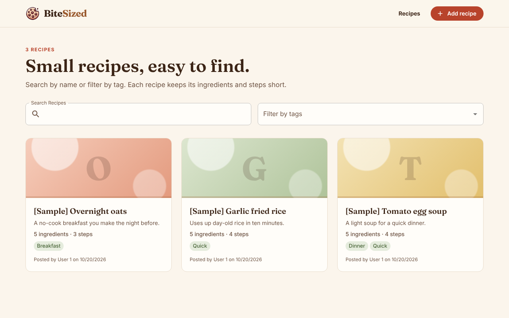
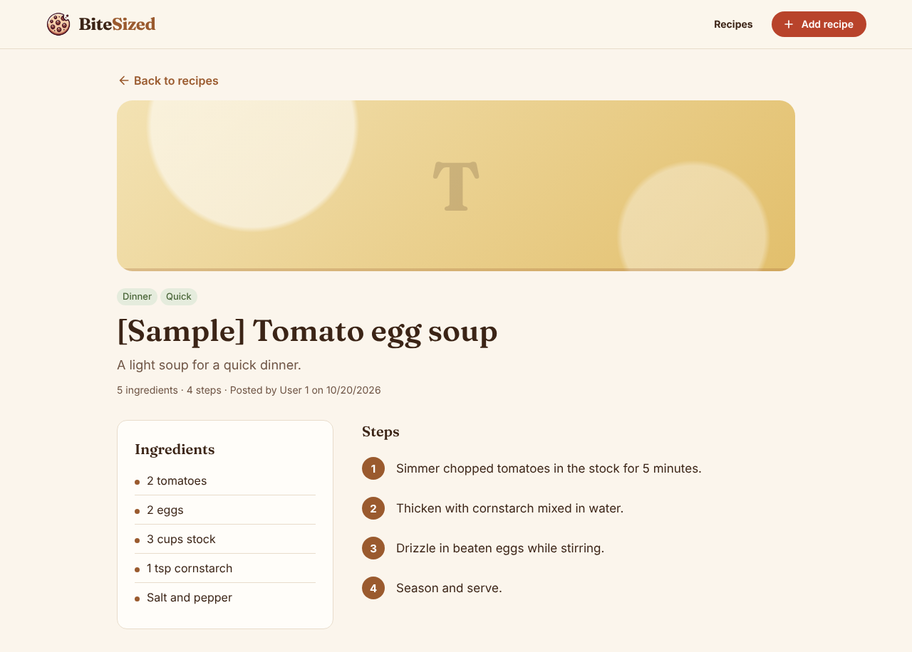
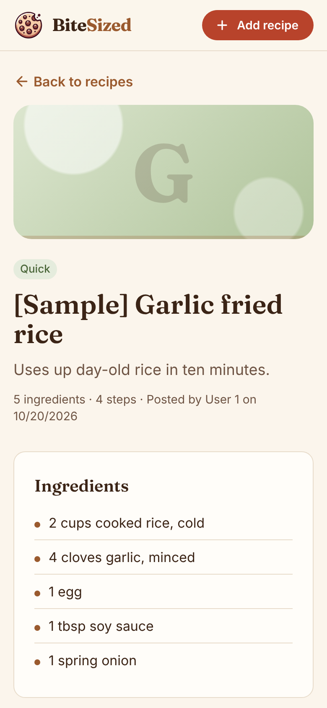
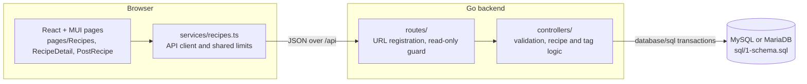

<p align="center">
  
</p>

<h1 align="center">BiteSized</h1>

<p align="center"><strong>Status: prototype.</strong> Recipes, tags, and posting work end to end. There are no user accounts yet, so the server is read-only by default.</p>

BiteSized is a small recipe board. You browse short recipes, narrow them by name or tag, open one to see its ingredients and steps side by side, and post your own when the server runs in authoring mode.



## What it does today

- **Browse and filter.** The recipe list searches by title and filters by any tag. Loading, empty, and error states each have their own screen, with a retry button for errors.
- **Read a recipe.** Each recipe page shows its tags, an ingredient list, and numbered steps. It works on a phone.
- **Post a recipe.** The form checks the same limits as the server (title length, up to 10 tags of 50 characters) before it sends anything.
- **Tags that do not duplicate.** `Breakfast` and `breakfast` map to one tag. The server picks the author, never the request.
- **Safe by default.** Every write returns 403 unless the backend starts with `AUTHORING_ENABLED=true`.

<p>
  
  
</p>

## Quickstart

You need MySQL or MariaDB, Go 1.23.4 or newer, Node.js, and yarn. Create an empty database and a user for it first, for example:

```sql
CREATE DATABASE bitesized;
CREATE USER 'your_user'@'localhost' IDENTIFIED BY 'your_password';
GRANT ALL ON bitesized.* TO 'your_user'@'localhost';
```

Then:

```bash
git clone https://github.com/KoalaLyfestyle/BiteSized.git
cd BiteSized/backend
cat > .env <<'EOF'
DB_USER=your_user
DB_PASSWORD=your_password
DB_HOST=127.0.0.1
DB_PORT=3306
DB_NAME=bitesized
EOF
go mod download
go run . -setup-db          # prints "Database is ready."
go run .                    # serves http://localhost:8080, read-only
```

In a second terminal:

```bash
cd BiteSized/frontend
yarn install --frozen-lockfile
yarn start                  # opens http://localhost:3000
```

You should see three recipes titled `[Sample] ...`, as in the screenshot above. To post your own, stop the backend and start it with `AUTHORING_ENABLED=true go run .`.

More detail: [docs/development.md](docs/development.md) (setup, tests, design system) and [docs/api.md](docs/api.md) (every endpoint).

## How it works



The frontend is a Create React App single page app with hash routes (`#/recipes`, `#/recipes/3`), so a refresh never needs server rewrites. It talks to a plain `net/http` Go server. Each recipe write runs in one transaction: the recipe row, then its tags, which are created when missing and linked through `recipe_tags`. Validation limits live in the controllers and are mirrored in `services/recipes.ts`, so the form catches mistakes before the request.

## Results and limits

Checked in this repo's tests:

- 28 frontend tests (`CI=true yarn test --watchAll=false`) cover the list, filters, recipe page, the post form, the branding files, and colour contrast.
- Go unit tests use `go-sqlmock`. An integration test (`go test -tags integration ./routes/`) runs the recipe and tag flow against a real MySQL or MariaDB database.

Left out on purpose, or not built yet:

- No accounts or login. That is why writes are off by default.
- Recipes have no photos. Each one gets a colour block with its first letter in the image slot until photos exist.
- The thread API works, but its pages are not routed.
- Known bugs are tracked as issues, for example emoji tags collapsing into one tag on MariaDB ([#8](https://github.com/KoalaLyfestyle/BiteSized/issues/8)).

## Design note

**Choice:** the server decides who wrote a recipe. With no login, trusting a `user_id` in the request would let anyone post as anyone. So the API rejects that field, saves new recipes as a configured author, and stays read-only unless you turn authoring on for your own machine.

**Cut:** user accounts with bcrypt password hashing were planned for the original CVWO brief and never finished. Rather than ship half an auth system, the app keeps writes local.

## Credits

Built by Winston Ho Rui Wei, first as a CVWO AY2024/25 submission. The cookie logo was made with OpenAI's DALL·E.
